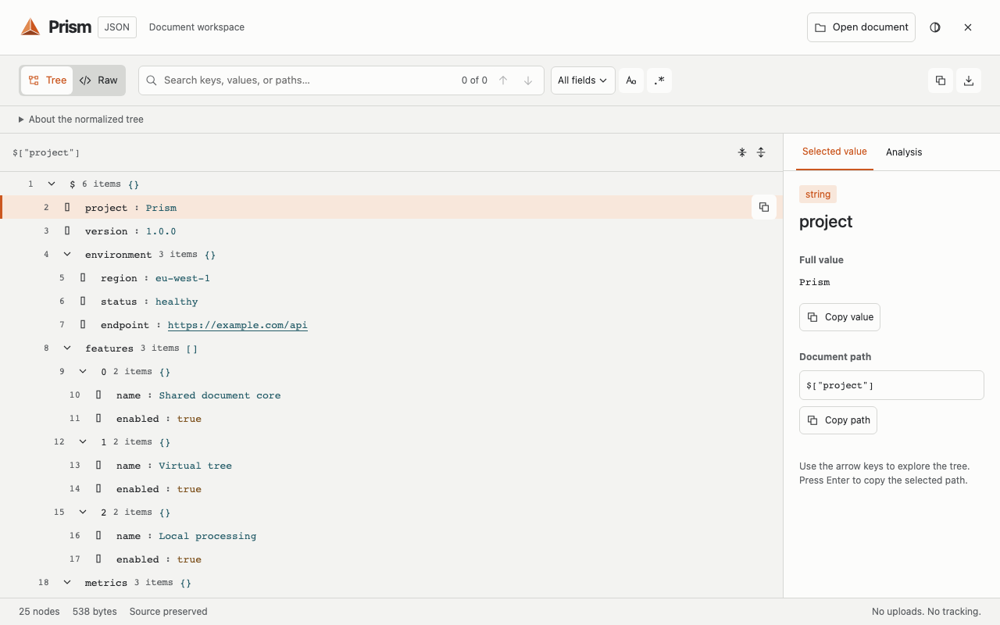

# Prism

A desktop JSON and XML viewer that runs locally in your browser. Explore a virtualized tree, search names and values, inspect full values, copy paths, and recover the original source.



Prism is an open-source extension under the MIT license. Chrome, Edge, and Firefox packages are generated from the same source. Store publication is separate from this repository; see [verification status](docs/verification.md) before treating a package as a release.

## Features

- One JSON/XML workspace with shared SVG controls and light, dark, and high-contrast themes.
- Search fields, literal/regular-expression matching, case sensitivity, next/previous navigation.
- Desktop inspector with full values, paths, and document analysis.
- Worker processing, cancellation, virtual rows, and bounded resource limits.
- Raw recovery, local file/paste opening, copy/download, and original-page restoration.
- No accounts, telemetry, external parser services, or document uploads.

## Develop

Use Node 24.15.0 and pnpm 10.4.1 (pinned in `package.json`).

```sh
pnpm install --frozen-lockfile
pnpm test
pnpm typecheck
pnpm lint
pnpm layers
pnpm build
pnpm test:browser
```

Install the local browser test binary once with `pnpm exec playwright install chromium`. The browser runner uses an isolated temporary profile and synthetic local fixtures. `PRISM_BROWSER=msedge pnpm test:browser` uses an installed Microsoft Edge.

Load `dist/chrome` or `dist/edge` as an unpacked extension from the browser's extensions page with developer mode enabled. In Firefox, use `about:debugging` → This Firefox → Load Temporary Add-on → `dist/firefox/manifest.json`. Unsigned temporary add-ons are removed when Firefox restarts.

`pnpm storybook` opens the shared component workbench. `pnpm build-storybook` produces a static workbench. No CI workflows are enabled automatically.

## Assets and packages

Brand rasterization uses Python 3 with Pillow. Install the version pinned in `requirements-assets.txt` in a virtual environment.

```sh
pnpm brand:assets
pnpm store:promos
pnpm build
pnpm store:assets
pnpm brand:check
pnpm verify-package
pnpm package
```

`pnpm package` creates local candidate ZIPs, source, checksums, and notes under ignored `artifacts/`. It does not certify store readiness. `pnpm release:prepare` additionally requires a clean committed tree and browser/performance/visual evidence. Version changes use Changesets and derive every manifest and filename from `package.json`.

## Limits and fidelity

Sources are limited to 20 MiB, 250,000 indexed nodes, depth 512, and ten seconds per worker job. JSON's tree is normalized by JavaScript parsing: duplicate keys and numeric precision can differ from the source. Raw view and download retain the acquired source. Native XML may be reconstructed from the browser's DOM and is explicitly labeled. Prism never silently refetches a document. Browser-internal pages and some CSP/XSLT contexts cannot host the viewer; use the standalone workspace.

See [architecture](docs/architecture.md), [privacy](docs/privacy.md), [security](SECURITY.md), [release instructions](docs/release.md), and [contributing](CONTRIBUTING.md).
